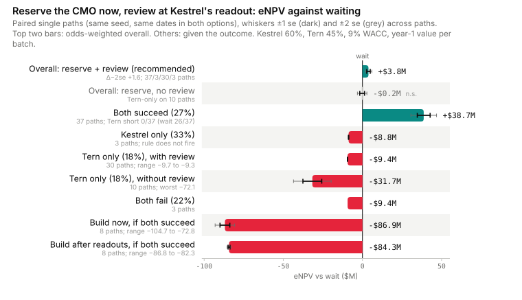

# Fill-finish capacity for Kestrel and Tern: what to take to ExCo

> The REPORT artifact (phase 4 of 4), revision 2 (turn 7). The recommendation comes first, then the numbers, then how they were computed. **Read this before any number below.** Each figure comes from single simulated paths, one per seed, with the readout outcomes forced. When both readouts succeed there are **37 paired paths** for wait and reserve-now (seeds 1–37). There are 8 for the two build options, and 3 for each other outcome. The same seed gives both options the same readout dates, slips and lead times. The four outcomes are combined using the stated odds (Kestrel 0.60, Tern 0.45, independent). The ± figures are standard errors across paths, and the probability ranges are 95% Wilson intervals on the path counts. The relayed 96-seed ensemble of the wait option serves as an independent check on the wait-option numbers.

## **Reserve the CMO slot now, usable by either asset: neutral in expectation (−$1.1M ± $3.4M vs waiting), and Tern's launch is fully supplied if both succeed**

**Recommendation: sign the reservation before 30 November 2026, usable for either asset. Do not build a second line. Do not use the Tern-only structure unless the second CMO contract is in writing.**

- **Money is neutral.** Against waiting, reserving now comes to **−$1.1M ± $3.4M**, so the plausible range runs from −$7.8M to +$5.6M. The value of the reservation sits entirely in the both-succeed world, where it is **+$38.7M ± $4.1M** and positive on 34 of 37 paths. In every other world it is a cost:

  | Outcome | Chance | Reserve now vs wait | Paths |
  |---|---|---|---|
  | Both succeed | 0.27 | +$38.7M ± $4.1M | 37 |
  | Kestrel only | 0.33 | −$8.8M | 3 |
  | Tern only | 0.18 | −$36.7M ± $17.7M | 3 |
  | Both fail | 0.22 | −$9.4M | 3 |

- **What it buys.** If both succeed and we wait, Tern is short at launch on **26 of 37 paths** (0.70, range 0.54–0.83), which is **0.19 overall (0.15–0.22)**. With the reservation it is short on **0 of 37** paths (at most 0.09 given both succeed, at most 0.025 overall).
- **What it does not buy: an on-time Tern filing.** When both succeed, Tern files late on 14 of 37 paths with the reservation (1–3 months) and on 13 of 37 under wait (2–3 months). Over all four outcomes the chance of a late filing is 0.162 with the reservation and 0.095 without.
- **Kestrel is never short at launch** under either option (0 of 37 paths).
- **Decision rule.** The brief's test was Δ − 2·se > 0, and on money it fails (−$7.8M). The honest statement is therefore "neutral in expectation". Reserve if ExCo values a fully supplied Tern launch in the both-succeed world above a premium of roughly zero, with exposure of $9.4M if both fail and $18.6M–$72.1M if only Tern succeeds.



*(The figure still shows last turn's 3-path values and is to be regenerated. The table below supersedes it.)*

## What each option costs and protects against

eNPV is in $M, at 9% WACC through end-2032, at the year-1 value per batch.

| Option | vs wait, overall | vs wait, if both succeed | Tern short at launch, if both succeed | Tern files late, if both succeed | Kestrel short at launch |
|---|---|---|---|---|---|
| Wait | — | — | 26/37 | 13/37 (2–3 months) | 0/37 |
| **Reserve now, either asset** | **−1.1 ± 3.4** | **+38.7 ± 4.1** | **0/37** | 14/37 (1–3 months) | 0/37 |
| Build after readouts | −23.0 (3 paths, turn 6) | −84.3 ± 0.6 (8 paths) | 6/8 | — | 0 |
| Build now | −105.8 (3 paths, turn 6) | −86.9 ± 3.1 (8 paths) | 6/8 | — | 0 |

**What a Tern shortfall costs.** When both succeed and we wait, Tern loses demand on **37 of 37 paths**, including paths that do not count as short at launch.

- **Size:** on average **10.7 batches, worth $50.9M PV**, with a range of 5.9–20.3 batches and $27.8M–95.9M.
- **Duration:** 5 to 10 months, starting just after Tern's launch (months 35–44 of the model, around late 2029 to mid 2030).
- **With the reservation:** Tern loses no demand on any of the 37 paths.

**Why the reservation sometimes loses money.** The reservation makes the CMO Tern's filed site. When Tern reads out early and the CMO is not yet qualified (12–15 months after signing), Tern's filing waits, while under wait Tern would have qualified on our own line.

- Both-succeed seed 2 shows it: Tern launches in month 33 instead of month 30, and the path comes to −$14.3M.
- All 3 negative both-succeed paths are this case (−$14.3M, −$3.7M, −$5.5M).
- So is the Tern-only path that costs $72.1M.

**Kestrel.** Under wait, Kestrel runs slightly short later in its life on 4 of 37 both-succeed paths, losing 0.5 to 3.7 batches, never in its first six months. With the reservation that happens on 0 of 37 paths.

## Sensitivities

On the 37 paired paths:

| Case | Reserve now vs wait, overall | If both succeed |
|---|---|---|
| Value per batch at the peak rate | +$15.0M ± $8.8M (−$2.5M to +$32.5M) | +$117.3M ± $10.5M, negative on 1 of 37 paths |
| Kestrel PoS 0.50 | −$4.5M ± $4.1M | — |

Also at the peak rate, the build options remain negative when both succeed: −$88.7M (build now) and −$85.0M (build after) over 8 paths.

**Still on 3 paths from turn 6, so indicative only and measured against the earlier base:**

- No second CMO contract: reserve-for-both +$16.3M, reserve-for-Tern-only −$72.5M. The latter is the one setup where Kestrel runs materially short: about 102–107 batches, all after its first six months.
- Literal allocation rule: reserve-for-both +$8.8M.
- A $5M walk-away: about +$1.0M.
- Even capex phasing: $0.95M worse.
- The 2-month Kestrel floor: no change.

**Tern-only structure.** "Reserve for Tern now, add a second slot later" ties reserve-for-both when a second contract exists (+$0.3M vs +$0.9M in turn 6, on 3 paths). It is far worse without one. It stays off the recommendation unless the second contract is written.

## Cross-check against the 96-seed wait ensemble

The ensemble (root seed 2609) realized success rates of Kestrel 0.5417 and Tern 0.3542. Our forced-world means for the wait option, reweighted to those rates, compare as follows:

| Measure | Our paths, reweighted | Ensemble | Agrees |
|---|---|---|---|
| eNPV | $751.2M | $765.96M ± $61.65M | yes |
| Chance Tern short at launch | 0.135 | 0.146 ± 0.036 | yes |
| Chance Kestrel short at some point | 0.021 | 0.021 ± 0.015 | yes |
| Tern demand lost | 20.6 tenths | 24.0 ± 5.0 tenths | yes |
| Late Tern filing, average months | 0.145 | 0.042 ± 0.029 | **no, about 3.5 standard errors apart** |

The late-filing mismatch is unexplained. The ensemble's per-seed samples, conditioned on both succeeding, would settle it. Until then, **the late-filing figures are the least reliable in this report.** The ensemble covers only the wait option, so it confirms the level of the wait figures but says nothing about the differences between options.

## What would change the answer

- **The reservation becomes clearly positive** if a batch is worth more than its year-1 rate: +$15.0M overall at the peak rate.
- **Whether a second contract really exists.** It is what separates reserving for both from reserving for Tern only.
- **Allowing Tern a backup qualification on our own line.** This would remove the reservation's one self-inflicted risk, the delay when the CMO qualifies late. It has not been modelled yet.
- **The Tern-only world** rests on 3 paths and supplies most of the ±$3.4M uncertainty.

## Caveats

- The horizon ends in 2032, so any value earned after 2032 is not counted. The build options are understated as a result.
- Kestrel's 15% share-loss penalty never triggered.
- Three inputs are the user's estimates without paperwork: the second contract, the reassignment of the slot, and +5%/yr marketed growth.
- The sensitivities other than peak value and Kestrel PoS 0.50 remain on 3 paths.

## Why a spreadsheet cannot produce this

The reservation's value exists only in the joint outcome where both succeed. In that outcome it depends on a race between Tern's readout date and two other timelines: the CMO's qualification lead time, and Kestrel's six-month stock build on the same own line. The same fee that protects Tern's supply in one race can delay Tern's filing in another. The net comes from month-by-month allocation under drawn dates, not from any per-asset expected value.

<details>
<summary>The model (click to expand)</summary>

The model is unchanged from turn 6. It is monthly, from 1 October 2026 to end-2032, with capacity counted in tenths of a batch. It uses the own line, the reserved CMO slot, a second CMO contract if both succeed, a possible second line, the readout draws, the regulatory clock including PAS, and the patient-first planner. It consists of 22 JSON documents from `gen_models.py` plus forced-outcome copies in `scenarios/`. Each option differs from waiting in one or two parameters (`cmo_now`, `cmo_reassign`, `build_now`, `build_after`).

</details>

## How the numbers were made

1. **Frame**: `BRIEF.md`.
2. **Author**: `gen_models.py`, all documents pass validation.
3. **Diagnose**: `DOCTOR.md`.
4. **Report**: 141 single-seed `rdx run` paths in total (90 this turn), every one `ok`. The command, output excerpt and exit code for each are in `capture_log.md`, turns 6–7.

The headline numbers come from:

```bash
(cd agent/studies/launch_supply && python3 paired_both.py)            # base case
(cd agent/studies/launch_supply && python3 paired_both.py --peak)     # peak value per batch
(cd agent/studies/launch_supply && python3 paired_both.py --pk=0.5)   # Kestrel PoS 0.50
```

Each path is determined by (document, seed), and the verbatim outputs are in `runs/`.
