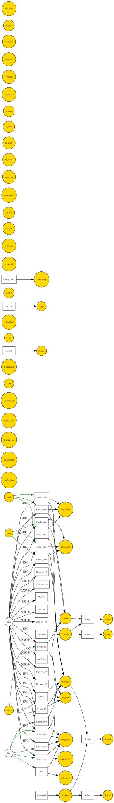

# Fill-finish capacity for Kestrel and Tern: what to take to ExCo

> The REPORT artifact (phase 4 of 4). The recommendation comes first, then the numbers behind it, then how they were computed. **Read this before any number below.** Every figure is a single simulated path, or an average of a few paths, combined across the four readout outcomes using the stated odds (Kestrel 0.60, Tern 0.45, independent). The ensembles were cancelled (see "How the numbers were made"). That is why no number carries an error bar: none was measured. Where the paths disagree, that is shown instead.

## **Reserve the CMO slot now, usable by both assets: about break-even in money (+$0.9M vs waiting), and it removes the risk of a supply-short Tern launch**

**Recommendation: sign the CMO reservation before 30 November 2026, with the slot usable for either asset. Do not build a second line, now or after the readouts. Do not tie the reservation to Tern alone unless a second CMO contract is genuinely available.**

- **Money: the CFO is right that it does not pay for itself on expected value.** In the base case (year-1 value per batch, 9% WACC, through end-2032), reserving now is worth **+$0.9M** of eNPV against waiting (weighted $847.9M vs $847.0M). That is a tie. Re-weighted path by path, the three both-succeed paths give **+$5.7M, −$12.2M and +$9.3M**, so even the sign is not settled.
- **What the fee buys is launch protection.** Reserving now takes the chance of a **supply-short Tern launch from 0.18 to 0.00**. It also takes the chance of **Tern filing late because its PPQ waits behind Kestrel on our own line from 0.18 to 0.00**.
- **What it costs if everything fails.** If both readouts fail, the reservation loses **$9.4M** of NPV (the walk-away).
- **Kestrel is not at risk at launch under any option.** P(supply-short Kestrel launch) is 0.00 under every option and every sensitivity we ran.
- **Decision rule.** The brief's rule was to act if the gain holds at its low end (Δ − 2·se > 0). It cannot be applied here, because no standard error was measured. On the money alone, the honest answer is "not distinguishable from waiting". The case for reserving is ExCo's first question, P(supply-short launch), bought for a bounded downside. **Reserve if ExCo will pay up to about $9M of NPV, the cost when both fail, to take Tern's supply-short-launch risk from about 1 in 5 to zero. Otherwise wait.**


## What each option costs and protects against

Base case: patient-first allocation, a 2-month Kestrel floor, and a second CMO contract signed if both assets succeed. eNPV is in $M. "Short" means demand went unmet in the asset's first six months.

| Option | eNPV | vs wait | P(Kestrel short at launch) | P(Kestrel short ever) | P(Tern short at launch) | P(Tern files late) | NPV if both fail |
|---|---|---|---|---|---|---|---|
| Wait | 847.0 | — | 0.00 | 0.00 | 0.18 | 0.18 | 0.0 |
| **Reserve CMO now, both assets** | 847.9 | **+0.9** | 0.00 | 0.00 | **0.00** | 0.09 | −9.4 |
| Reserve CMO now for Tern, second slot later | 847.2 | +0.3 | 0.00 | 0.09 | 0.00 | 0.09 | −9.4 |
| Build second line after readouts | 824.0 | −23.0 | 0.00 | 0.00 | 0.18 | 0.18 | 0.0 |
| Build second line now | 741.1 | −105.8 | 0.00 | 0.00 | 0.18 | 0.18 | −123.9 |

How to read the probabilities. Supply trouble only arises when **both** readouts succeed, which happens with probability 0.27. A 0.18 is that 0.27 multiplied by 2 of the 3 both-succeed paths; a 0.09 is 1 of the 3. These are counts on three example paths, not measured frequencies.

- **Wait.** On 2 of 3 both-succeed paths, Tern's PPQ waits behind Kestrel's stock build on our own line. Tern then files **2 months late** and launches short, losing 6.2 to 11.0 batches of demand. Kestrel is never short.
- **Reserve now, both assets.** Tern files with the CMO as its site, so its PPQ never competes with Kestrel. Tern is never short and never loses demand. **The one late filing (3 months) has a different cause.** On that path Tern read out early and the CMO was not yet qualified (12–15 months after signing). Reserving removes the "stuck behind Kestrel" delay entirely, but not every delay. If only one asset succeeds, the reservation costs a little against waiting: Kestrel only $1,087.4M vs $1,096.2M; Tern only $420.3M vs $438.9M.
- **Build now.** Capex is committed whatever the readouts show: the option loses $123.9M if both fail. Worse, the line is not ready in time to help either launch. Tern's shortfall and late filing are the same as under waiting. This confirms the prior that a build is a long-term capacity decision, not launch insurance.
- **Build after the readouts.** It costs $23.0M against waiting and protects neither launch, for the same reason.

## Your turn-5 questions

**Is Kestrel ever at risk, even after its first six months?** Yes, in one setup: **the slot reserved for Tern only, and no second CMO contract available.** Kestrel then runs short on all three both-succeed paths, losing 101.6 to 106.9 batches of demand (1016 to 1069 tenths), all after its first six months. Weighted, that is P(Kestrel short ever) = 0.27. Two smaller cases also appear:

- Tern-only with a second contract: 0.8 batch on one path, at the hand-over to the second contract.
- Waiting with no second contract: 3.2 and 1.3 batches on two paths.

**Odds that Tern files late because its PPQ is stuck behind Kestrel:**

| Option | P(late) | How late |
|---|---|---|
| Wait | 0.18 | 2 months |
| Build now | 0.18 | 2 months |
| Build after the readouts | 0.18 | 2 months |
| Either reserve-now option | 0.00 for this cause | — |

The reserve-now options still carry 0.09 of a 3-month delay, from the CMO not being ready in time. At your "two months off Tern's launch" rule, that is the price of the option that removes the larger risk.

**Does "reserve for Tern now, add a second slot later" beat "reserve now for both"?** **No. It ties at best, and it loses badly if the second slot does not materialise.**

- With a second contract available on your terms, the two are the same within noise: +$0.3M vs +$0.9M.
- Without a second contract, Tern-only is the worst CMO option. It comes to **−$72.5M** against waiting, while reserve-for-both comes to **+$16.3M**. It is also the one setup where Kestrel runs short.
- The second contract is your estimate, with no term sheet, so **the finding is: reserve for both.** The Tern-only structure only matches it if someone can put the second contract in writing.
- One check to make before signing: the model assumes the term sheet reserves capacity, not a product, so Kestrel can move in if Tern fails. That was your reading, and it is not confirmed. If the slot turns out to be product-locked, the Tern-only numbers are the ones that apply.

## What would change the answer

All figures are against the matching wait option, over the same paths.

| If… | Reserve now, both | Reserve for Tern only | Build now | Build after |
|---|---|---|---|---|
| Base case | +0.9 | +0.3 | −105.8 | −23.0 |
| **Value per batch at the peak rate, not year-1** | **+20.4** | +19.3 | −105.9 | −23.2 |
| **No second CMO contract** | **+16.3** | **−72.5** | not run | not run |
| No second contract, at peak value | +61.1 | −86.2 | not run | not run |
| Your literal allocation rule (Kestrel's full buffer before any Tern batch) | +8.8 | +8.6 | not run | not run |
| Literal rule, at peak value | +41.1 | +40.8 | not run | not run |
| **Kestrel PoS 0.50 (your own belief)** | **−1.5** | −2.0 | −107.9 | −19.1 |
| Walk-away after failure costs $5M (as quoted in the room), not $10M | +1.0 on top | +2.5 on top | — | — |
| Capex spread evenly, not 20/50/30 | — | — | $0.95M worse | — |
| No 2-month Kestrel floor | no change | not run | not run | not run |

- **The recommendation strengthens** if a batch is worth more than its year-1 rate, if the second contract is uncertain, or if the allocation really is the literal rule. In each of those cases reserving now is clearly positive.
- **It weakens to a tie** at Kestrel PoS 0.50 (−$1.5M). Even there, the protection of Tern's launch is unchanged.
- **Building is negative in every case we tested.**
- **The 2-month floor made no difference.** It reproduced the base paths exactly: with capacity available, Kestrel's stock never falls near it, and without capacity it cannot be met anyway.

## Caveats (scope, not apology)

- **Few paths.** When both succeed, each option was run on 3 paths (seeds 1–3), with the same seeds, and therefore the same readout slips and lead-time draws, across options. Each single-asset world and the both-fail world rest on **one** path. The spread in the both-succeed world is material: the reserve-now gain ranges from −$14.3M to +$65.2M across the three paths. So the weighted eNPV figures are indicative, and a 1-in-3 count is not a probability estimate.
- **Horizon truncation.** Everything stops at end-2032, while both assets are still selling and any second line would still be running. So the eNPVs undercount value after 2032. **The build options are understated** by whatever the line earns after 2032. That is a direction, not a reversal: capacity arriving after both launches does not change P(supply-short launch).
- **Kestrel's 15% share-loss penalty never triggered**, because Kestrel was never short in its first six months. The result does not depend on how that penalty is sized.
- **Assumptions you gave us without paperwork:** the second contract's terms and timing; reassignment of the reserved slot; marketed volume growth of +5%/yr.
- **The one completed 96-seed ensemble** (baseline wait option, root seed 2609) was relayed as a file. **It was not read.** Under this session's rules nothing outside the conversation may be consulted. If you want it as a cross-check on the wait figures here, paste its result into the conversation.

## Why a spreadsheet cannot produce this

Priced asset by asset, as in the CFO's frame, a reserved slot for either asset is simply an expected fee against an expected shortfall. That comes out close to zero, and the model agrees on the money. What a per-asset view cannot see is *which* risk the fee removes. The exposure exists only in the 0.27 world where both succeed, and there three timed things collide:

- Tern's three PPQ batches must be done before filing, on whichever site it files with.
- Kestrel's six-month stock build is running on the same own line in the same months.
- The only way onto any other site is a PAS, about 6 months after approval.

Change the Tern readout date by a few months and the collision moves. On one path it vanishes under waiting, and instead the CMO's own lead time bites. The value of the slot is a race between readout dates and qualification lead times, decided month by month by the allocation rule.

<details>
<summary>The model: what is in it (click to expand)</summary>

One monthly model, from 1 October 2026 (t = 0) to end-2032 (t = 75). Capacity is counted in tenths of a batch; money is in $M (the cash pool is in $0.001M).

| Element | What it is | Role |
|---|---|---|
| Own line | 12.8 effective batches/month, marketed products first (9/month today, +5%/yr) | reusable capacity, held for a month and returned |
| CMO slot | up to 4 batches/month, ready 12–15 months after signing | appears on the ready date; $5M/yr in advance, 3-year minimum, $0.4M/batch |
| Second CMO contract | same terms, signed if both assets succeed | Kestrel and Tern reach it by PAS |
| Second line | 12 batches/month, ready 30–36 months after approval | $120M capex phased 20/50/30, $10M/yr fixed once operating |
| Readouts | Kestrel 0.60, ~March 2027 + 0–2 months; Tern 0.45, ~Dec 2027 ± 3 months | drawn once at t = 0 |
| Regulatory clock | readout + 3 → filing, + 12 → approval, + 1 → launch; filed site needs 3 PPQ batches before filing; other sites by PAS (~6 months) | rules on the drawn dates |
| Planner | each month allocates next month's capacity: Kestrel launch build and demand → Tern PPQ → Tern → Kestrel buffer; each tier own line → line 2 → CMO → second CMO | the contention rule (patient-first; literal rule as sensitivity) |

The model is data: 22 JSON documents written by `gen_models.py`, plus 44 forced-outcome copies in `scenarios/`, with no custom code. Each option differs from waiting in one or two parameters:

```diff
  model.rdj.json               {}                                          wait
+ arm_cmo.rdj.json             {"cmo_now": 1.0}                            reserve now, usable by both
+ arm_cmo_tern_only.rdj.json   {"cmo_now": 1.0, "cmo_reassign": 0.0}       reserve now for Tern
+ arm_build_now.rdj.json       {"build_now": 1.0}
+ arm_build_after.rdj.json     {"build_after": 1.0}
```

</details>

<details>
<summary>Execution map: the wait option, both succeed, seed 1</summary>



The model's structure, decorated with run statistics from the wait option when both readouts succeed (seed 1). This is the path on which Tern's PPQ waits behind Kestrel on the own line and Tern files 2 months late.

</details>

## How the numbers were made

1. **Frame**: `BRIEF.md`, signed off in turn 4, with the turn-5 corrections folded in.
2. **Author**: `gen_models.py` writes 22 documents. All pass `rdx validate` with no errors.
3. **Diagnose**: `DOCTOR.md`. Every diagnosed arm is 7 pass · 1 warn · 1 fail or 6 pass · 2 warn · 1 fail. The fail is `transitions_fire`, on transitions that are unused by design. The warns are `horizon_sufficient`, carried into the caveats, and `bounded_pools` on capacity-used tallies. The own line is confirmed as the binding resource.
4. **Report**: the ensembles were cancelled by the operator after the first took 53 minutes. In their place:
   - each of 11 option variants was forced into each readout world (both succeed / Kestrel only / Tern only / neither);
   - the variants were run with single-seed `rdx run` calls: seeds 1–3 when both succeed, seed 1 otherwise, the same seeds for every option, 51 runs in all, every one `ok`;
   - the seeds were averaged within each world, and the worlds were weighted by 0.27 / 0.33 / 0.18 / 0.22.
   - eNPV is recomputed from each run's monthly flows with the `rdx enpv` discounting (flow / 1.09^(t/12)) and checked against each run's ledger.

Replay from the repository root:

```bash
python3 agent/studies/launch_supply/gen_models.py
agent/studies/launch_supply/run_scenarios.sh arm_cmo both 1 model both 1   # … one triple per path; see capture_log.md turn 6
python3 agent/studies/launch_supply/analyze.py              # base case
python3 agent/studies/launch_supply/analyze.py --peak       # peak value per batch
python3 agent/studies/launch_supply/analyze.py --pk=0.5     # Kestrel PoS 0.50
(cd agent/studies/launch_supply && python3 paired.py)       # path-by-path deltas
```

Each run is determined by (document, seed). Rerun a triple and you get the same path, byte for byte. Every command and its output is in `capture_log.md` (turns 1–6), and the verbatim run outputs are in `runs/`.

## Cheap next steps (say which, if any)

- Put the second contract's terms in writing, or ask the CMO for them. That single fact decides between the two reservation structures.
- Rerun the single-asset worlds on seeds 2–3 so they rest on more than one path: 12 more runs, about 8 minutes.
- Test a fallback where Tern's PPQ may run on our own line if the CMO is not qualified in time. That would target the one remaining 3-month late-filing path under reserve-now.
