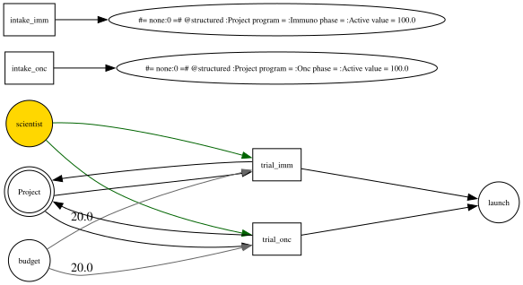

# What is the fifth scientist worth?

> The REPORT artifact (AGENT_WORKFLOW_CHARTER §3.4), written to the case-study signature from `spec/DOCS_CHARTER.md` §2: the number and the verdict first, the decision rule that falls out of it, why a spreadsheet cannot produce it, and only then how it was computed.

## **+\$19.0M ± \$2.5M** — hire them

The fifth scientist is worth **\$19.0M in expected NPV over the 48-month plan**, with a standard error of \$2.5M. Expected NPV rises from **\$88.0M** at four scientists to **\$107.0M** at five. The effect is 7.5 standard errors from zero, so it is a real marginal gain rather than ensemble noise.

**Decision rule: hire iff the fully loaded cost of the scientist over the 48-month horizon is below \$19M.** At any realistic loading — a few \$M per year — that is a clear yes, and the hire should be read as value-accretive capacity, not a cost to be minimized. Because the shadow price *falls* as the bench stops binding, the same comparison re-run at 5-vs-6 and 6-vs-7 traces the diminishing-returns curve the headcount plan should follow; hiring should stop where the curve crosses the loaded cost.

Two caveats travel with the number. It counts only value realized **within 48 months** — two trials are still running at the horizon and the candidate queue is still growing, so \$19M is a **lower bound** on the value of relieving the bench. And it is a portfolio-level number under this contention rule: oncology is protected by priority, so most of the unlocked value lands there (21 oncology launches to immunology's 7 in the reference run).

## Why a spreadsheet cannot produce this

A spreadsheet can compute what a scientist *costs*. The \$19M is not a property of the scientist at all — it is the portfolio's marginal response to relieving a binding constraint, and it exists only because three things are true at once: the bench genuinely runs out (trough of **0** scientists), a trial *holds* its people for four months before returning them, and when both franchises want the bench in the same month something has to decide who waits. Change any one of those and the number changes. Add enough scientists and it collapses toward the accounting cost — which is exactly the signal that hiring should stop, and exactly what a per-head cost model cannot express.

The value also arrives through a path no closed form captures: the fifth scientist does not produce launches, they let trials *start* that would otherwise have queued, and some fraction of those launch four months later, 55% of the time, in whichever franchise the allocator staffs next.

## The model

<details>
<summary>Formalism — places, transitions, modalities (click to expand)</summary>

Two therapeutic franchises share one finite scientist bench. Each franchise takes in candidate assets at 1.5/month and runs each through a trial that holds **1 scientist** and draws **20 \$k/month** of budget for **4 months**, then launches with probability **0.55**.

| Element | Kind | Role |
|---|---|---|
| `scientist` | plain place, `init = 4` | the scarce resource; held by an arc with modality `return: conserved` — occupied for the cycle time, returned intact |
| `budget` | plain place, `init = 1e9`, `cost = 1` | metered per month (`allocation: perstep`) out of a deep pool, so money is a real ledger cost but never the constraint |
| `Project` | structured place | candidate assets; each token carries `program` (`:Onc`/`:Immuno`), `phase`, `value` |
| `launch` | plain place, `reward = 4000` | the product that carries value — credited on *production*, so reward realizes at a successful launch, never at intake |
| `intake_onc` / `intake_imm` | transitions, rate 1.5 | genesis of new candidates into each franchise |
| `trial_onc` / `trial_imm` | transitions, `cycletime = 4`, `prob_of_success = 0.55`, `priority` 3.0 / 1.0 | select an active candidate of their franchise, hold a scientist, advance the survivor to `:Launched` and emit a `launch` |

The priority split is the contention rule: when more trials are ready than the bench can staff, the priority-weighted allocator (ADR 0002) rations scientists in proportion to priority, so oncology is staffed first and immunology queues.

Units: pool quantities in \$k; a launch is \$4,000k = \$4M; results reported in \$M, monthly ticks discounted at 8% annual.

The model is **data** — two JSON documents in this directory, differing in exactly one line:

```diff
  { "name": "scientist",
-   "init": 4.0 }
+   "init": 5.0 }
```

That diff *is* the lever. The only Julia in the study is `host.jl`, which supplies the token type and maps the kind name `Project` to a constructor; no Julia crosses the JSON boundary.

</details>

<details>
<summary>Hero visual — the execution map</summary>



The map decorates the net's structure with run statistics. `scientist` is painted as the starved pool — the resource the whole portfolio is short of. `budget` never starves despite being a real cost, so it is not the constraint. The arcs carry the modality that makes the bench behave like headcount rather than like fuel.

</details>

## How we got it

1. **Frame** — the decision, the slots, and the pre-registered failure modes: `BRIEF.md`.
2. **Author** — `model.rdj.json` (four scientists) and `arm_hire_fifth.rdj.json` (five). Both pass `rdx validate` with zero diagnostics.
3. **Diagnose** — 8 pass, 1 warn, 0 fail against the brief's pre-registered intent: `DOCTOR.md`. The warn is the horizon truncation, carried into the caveats above rather than fixed.
4. **Report** — the two-arm treatment effect, 48 members per arm from root seed 2026:

```bash
julia --project=. agent/scripts/rdx.jl effect \
  agent/studies/marginal_scientist/model.rdj.json \
  agent/studies/marginal_scientist/arm_hire_fifth.rdj.json \
  --host=agent/studies/marginal_scientist/host.jl \
  --metric=enpv --scale=0.001 --annual=0.08 --seeds=48 --root-seed=2026
```

Member *k* of each arm is seeded from `hash((2026, k))`, so the two arms are compared on the *same* seed stream and every number above is replayable from `(model, seed)` alone — rerun the command and you get \$18.991M again, not a number near it.

## Provenance

This study is the workflow's **known-answer acceptance test**. The published case study `docs/literate/case_studies/marginal_scientist.jl` builds the same model in the Julia DSL and reports ≈ +\$19M ± \$2.5M. The workflow reproduces it to the digit (+\$18.991M, se \$2.528M) through the JSON-document path — which is the evidence that the agent-facing surface and the hand-authored surface are the same engine, not an approximation of it.
