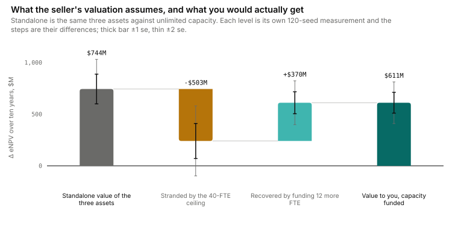
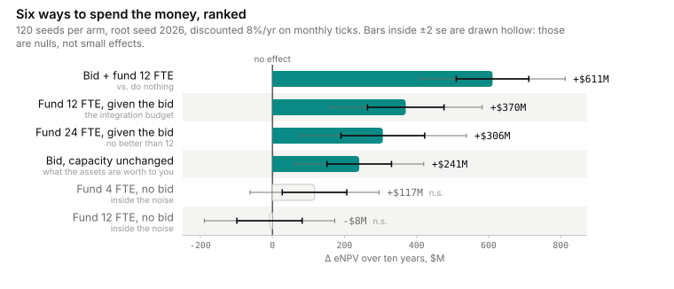
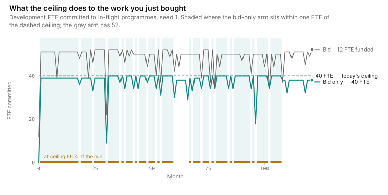
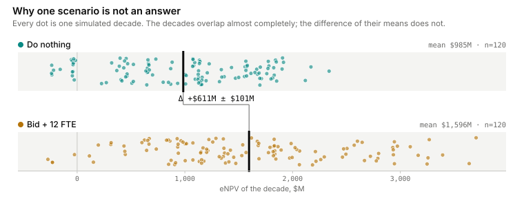
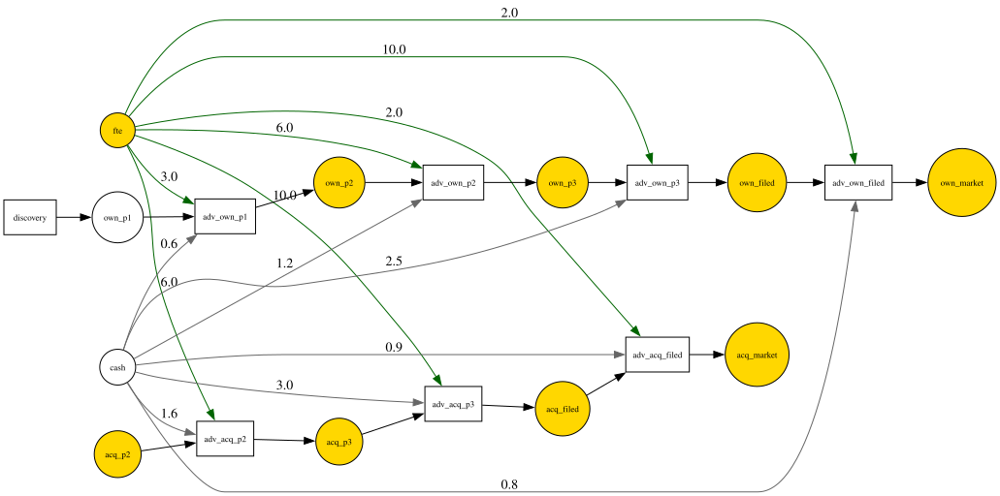

# What are three in-licensed assets worth to a development group that is already full?

> The REPORT artifact (AGENT_WORKFLOW_CHARTER §3.4), written to the case-study signature from `spec/DOCS_CHARTER.md` §2: the number and the verdict first, the decision rule that falls out of it, the mechanism and its limits, and only then how it was computed. Every figure quoted here traces to a command and an envelope in [`README.md`](README.md). One tick is one month, all money is \$M, all capacity is FTE; eNPV discounts monthly ledger flows at 8%/yr over a ten-year horizon.

## **\$503M ± \$169M stranded** — bid against +\$241M, not \$744M

Against unlimited development capacity, the three assets are worth **+\$744M ± \$144M** of expected NPV over ten years (5.17 se from zero). That is the seller's valuation, reconstructed inside our own model by removing one thing only: the constraint that two programmes cannot use the same person at the same time. Against our actual 40-FTE development group, the same three assets, with the same economics and the same probabilities of success, deliver **+\$241M ± \$90M** (2.69 se). The difference is **+\$503M ± \$169M, 2.97 standard errors from zero** — real, not noise, and not a discount you can negotiate. It is what capacity costs, and it is the whole study.

| Valuation of the same three assets | Arms compared | Δ eNPV | se | se from zero |
|---|---|---|---|---|
| The seller's — unlimited capacity | `uncapped_baseline` → `uncapped_acquire` | **+\$744M** | 144 | 5.17 |
| Ours — 40 FTE, capacity unchanged | `model` → `arm_acquire` | **+\$241M** | 90 | 2.69 |
| **Stranded value** — the difference | independent arm means, se by root-sum-square | **+\$503M** | 169 | 2.97 |



## The decision rule

**Bid against what the package delivers to us, and decide the second cheque first, because it changes which number that is.** Capacity unchanged, the assets are worth +\$241M ± \$90M. Fund twelve more development FTE alongside the bid and the programme is worth +\$611M ± \$101M (6.07 se) — of which +\$370M ± \$106M is bought by the people, not by the assets.

| Decision | Δ eNPV | se from zero | Conservative floor (Δ − 2·se) | Rule |
|---|---|---|---|---|
| Bid for the three assets, capacity unchanged | **+\$241M ± \$90M** | 2.69 | **≥ \$62M** | this is the bid ceiling, not the \$744M on the term sheet |
| Fund **12 FTE given the deal** | **+\$370M ± \$106M** | 3.48 | **≥ \$158M** | fund it — the best-value line item in the programme |
| Fund 24 FTE given the deal | +\$306M ± \$116M | 2.64 | — | do not: indistinguishable from twelve, so buy the cheaper dose |
| Fund 12 FTE **without** the deal | −\$8M ± \$91M | 0.09 | — | do not: a dead null |
| Fund 4 FTE without the deal | +\$117M ± \$90M | 1.31 | — | do not: inside the noise |
| **The combined programme** | **+\$611M ± \$101M** | 6.07 | **≥ \$409M** | the cheque the whole transaction has to clear |



Three scope statements travel with those numbers, carried down from [`DOCTOR.md`](DOCTOR.md) rather than discovered later. **Every figure here is a lower bound**: 7 firings in the baseline and 9 in the funded programme are still in flight at month 120, so a Phase III started in year nine draws its cash inside the window and books its launch outside it. **That truncation, not diminishing returns, is the most likely reason +24 FTE measures less than +12** — twenty-four people start more work and the extra launches fall past the horizon where the ledger cannot see them. And this is a valuation of *the gap*, not of the assets: the \$1,400M-per-launch reward and the stage success rates are illustrative inputs, so what is defensible here is the shape and size of the capacity penalty, not a diligence price.

## The second cheque is the finding

Twelve FTE are worth **−\$8M ± \$91M** on their own — 0.09 standard errors from zero, as clean a null as this study produced — and **+\$370M ± \$106M** once you own the assets. Same twelve people, same cost, same document but for one line. Capacity is worthless standing alone in this pipeline and becomes the highest-return line item in the transaction the moment there is acquired work waiting for it. That asymmetry is structurally invisible to an NPV model, which prices the assets and the headcount as separate rows and then adds them: the additive answer would have been −\$8M for the people and +\$744M for the assets, and it would have been wrong about both. The practical consequence: the integration budget is not overhead attached to the deal, it is the part of the deal that recovers the seller's valuation, and at a floor of \$158M it is cheap against any twelve-FTE loaded cost.

The asymmetry can be put as a single question with a single error bar — *is the same twelve FTE worth more with the deal than without it?* — and it survives being asked that way. The contrast (`arm_both` − `arm_acquire`) − (`arm_capacity` − `model`) is **+\$378M ± \$140M, 2.71 se from zero**: the two levers are **complements**, and the combination beats the sum of its parts by a floor of roughly \$99M. Quote that floor rather than the point estimate — 2.71 se clears this study's bar without much room to spare.

## The mechanism, and the control that proves it

The penalty is not an accounting artifact — it is measured crowd-out of our own pipeline, and the control isolates its cause.

| Comparison | Own launches (`final:own_market`) | Own Phase II completions (`successes:adv_own_p2`) |
|---|---|---|
| Deal at 40 FTE (`model` → `arm_acquire`) | 2.842 → 2.542, Δ **−0.300 ± 0.144** (2.08 se) | 4.108 → 3.392, Δ **−0.717 ± 0.171** (4.19 se) |
| Deal with the ceiling removed (`uncapped_baseline` → `uncapped_acquire`) | 4.575 → 4.708, Δ +0.133 ± 0.243 — **null** | 8.383 → 8.558, Δ +0.175 ± 0.360 — **null** |
| Deal plus 12 FTE (`model` → `arm_both`) | 2.842 → 2.808, Δ −0.033 ± 0.147 — **null** | 4.108 → 4.825, Δ **+0.717 ± 0.179** (4.01 se) — *gains* |

Buying the three assets at today's capacity costs a third of an own-pipeline launch and three quarters of an own Phase II completion. Remove the ceiling and both effects vanish; **nothing changed between the first row and the second except `fte.init`**. Fund twelve more people and the crowd-out is gone while our own pipeline finishes *more* Phase II work than it did before the deal. The queue gauge moves with it: the deepest the preclinical backlog gets (`max:own_p1`) runs 25.7 in the baseline, 27.6 with the deal, 20.8 with the deal plus 12 FTE, and 4.0 with the ceiling removed — a backlog peaking near 26 in a pipeline that opened with 4 assets is the shape of the constraint. In launches rather than dollars, the ceiling strands **+0.383 ± 0.094** acquired launches per decade (4.06 se), and funding the integration capacity buys essentially all of them back: 0.975 ± 0.072 acquired launches against the uncapped arm's 0.917 ± 0.072.



The single-seed trace makes it concrete. All three assets land in `acq_p2` in month 8. At today's capacity they begin Phase II in months 25, 31 and **39** — the third asset sits on the shelf for 31 months, paid for and idle, while our own late-stage programmes hold the people. Fund twelve more FTE and two of the three start in month 9, the month after close.

## What this study does not support

Reported with the same prominence as the wins, because the nulls are where a briefing like this usually oversells.

- **That the complementarity is worth precisely \$378M.** The interaction clears at 2.71 se — above this study's ±2·se bar, and not far above it. Its floor is about **+\$99M**, an interaction half this size would not have separated from zero at 120 members at all, and the defensible sentence is "the combination beats the sum of its parts", not the point estimate.
- **That 24 FTE beats 12.** +\$306M against +\$370M, a difference of 64 against a se of **125** (0.51 se). Indistinguishable; fund the cheaper dose. Note the estimator trap underneath that number: those two effects *share* `arm_acquire`, so the se has to be rebuilt from the arm sems — differencing the two effect standard errors counts the shared arm's variance twice and inflates it to ~157. A contrast of contrasts is always built from arm sems; differencing effect ses is valid only when the two effects share no arm.
- **A dose-response curve.** Three doses are measured — +4 and +12 without the deal, +12 and +24 with it — with sems near 90. Three points do not determine a shape. This supports *fund twelve alongside the deal*, not *twelve is optimal*.
- **Anything beyond month 120.** Both arms warn `horizon_sufficient`; every number above is a lower bound.
- **A valuation of the assets themselves.** The per-launch rewards and stage success rates are illustrative. The measured quantity is the gap between a valuation that ignores capacity and one that does not, and that gap is a property of the constraint, not of the price.
- **A number for a different organisation.** The 40-FTE ceiling, the per-stage FTE loads and the priority order produce the entire result. Change them and every figure moves.



One diagnostic honestly moves the wrong way, and it is worth knowing before someone else finds it. The *baseline* is the most saturated arm: it sits within one FTE of the ceiling on 96 of 122 ticks (79%), against 81 (66%) with the deal and 52 (43%) with the deal plus twelve people. Utilization falls as the system gets less constrained, for a fragmentation reason — with no acquired work competing, the group packs tightly into its own pipeline, and a 6-FTE Phase II start does not fit the gaps a 40-FTE ceiling leaves once larger programmes are resident. So the argument above is made from queue-wait and launch counts and never from a saturation percentage. A diagnostic that moves the wrong way for a mechanical reason should be dropped, not explained.

## Why a spreadsheet cannot produce this

Three assets and unlimited people is arithmetic: value each asset, discount, add. Three assets and 40 *shared* people is a queue, and a queue's output is not a function of its inputs' averages — it depends on which programme is holding ten people this month, for how long it holds them, and who the allocator admits when both want the same ten. That is why the same three assets are worth +\$744M in one arm and +\$241M in another with every asset-level input identical, why twelve people are worth −\$8M alone and +\$370M in combination, and why the third acquired asset waits 31 months in a model where nothing about it changed. No closed form gets to a 31-month wait.

## The model

<details>
<summary>Formalism — places, transitions, modalities, and the lever as a diff (click to expand)</summary>

Eleven places, eight transitions, twenty-nine arcs. **No structured tokens and no `host.jl` — the entire study is data**, and `rdx validate` reports zero diagnostics on all nine documents.

| Element | Kind | Role |
|---|---|---|
| `fte` | plain place, `init = 40` | the scarce resource. Held by an `upfront` / `conserved` / `block` arc: claimed in full at start, returned at completion, and a programme that cannot claim its people does not start. `conserved` rather than `consumed` is the modelling claim that makes this a capacity study and not a budget study — people come back, money does not |
| `cash` | plain place, `init = 6000`, `cost = 1.0` | metered `perstep` / `consumed` while work is in flight, out of a pool deliberately deep enough never to bind; a real ledger cost, never the constraint |
| `own_p1` 4 / `own_p2` 4 / `own_p3` 3 / `own_filed` / `own_market` | plain places | our own pipeline by stage; `own_market` carries `reward = 900.0` |
| `acq_p2` / `acq_p3` / `acq_filed` / `acq_market` | plain places, `init = 0` | the acquired pipeline; `acq_market` carries `reward = 1400.0` — an in-licensed launch is worth more per unit than a home-grown one |
| `adv_own_p1` … `adv_own_filed` | transitions: 3 FTE / 18 mo / PoS 0.55; 6 / 24 / 0.38; 10 / 30 / 0.62; 2 / 12 / 0.90 | each takes its stage place, holds FTE for the whole duration, meters 0.6–2.5 \$M/month, and emits into the next stage on success |
| `adv_acq_p2` / `adv_acq_p3` / `adv_acq_filed` | transitions: 6 FTE / 14 mo / 0.48; 10 / 30 / 0.65; 2 / 12 / 0.90 | the acquired ladder, metering 0.9–3.0 \$M/month |
| `discovery` | transition, Poisson `rate = 0.35` | ≈4 new preclinical candidates a year; the only transition with no input arc |
| `priority` 1.0 / 2.0 / 3.0 / 4.0, and **2.5** on `adv_acq_p2` | the contention rule | late-stage work outranks early-stage work, with the acquired Phase II asset ahead of our own Phase II and behind our own Phase III. The priority-weighted allocator (ADR 0002) rations `fte` accordingly |

All seven `adv_*` transitions carry `rate = 3.0` with `rate_mode = "deterministic"` — the intent is *start everything you can afford to start*, so the queue that forms is caused by FTE scarcity and not by a sampling rate. Units: one tick is one month (`meta.dt = 1.0`, `meta.tspan = 120.0`), money is \$M throughout, so `--scale` stays at 1.0; eNPV discounts at 8%/yr over 12 periods per year.

The lever is one appended `rules` block that fires once at month 6, so `diff model.rdj.json arm_both.rdj.json` *is* the intervention — the arms differ by nothing else, not a rate, not a cycle time, not a seed:

```diff
@@ -403,6 +403,48 @@
       "side": "rhs",
       "place": "own_p1",
       "multiplicity": 1
+    }
+  ],
+  "rules": [
+    {
+      "id": "deal_closes",
+      "guard":  { "node": "call", "op": ">", "args": [ { "node": "timeref" }, { "node": "const", "value": 6.0 } ] },
+      "action": { "verb": "seq", "stmts": [
+        { "verb": "set_marking", "name": "acq_p2", "value": { "node": "const", "value": 3  }, "mode": "inc" },
+        { "verb": "set_marking", "name": "fte",    "value": { "node": "const", "value": 12 }, "mode": "inc" }
+      ] },
+      "fire_mode": "once"
     }
   ]
 }
```

(The hunk is the real one — 42 lines added, none removed; the JSON is re-flowed onto fewer lines here for legibility.) `arm_acquire` appends the same block with only the `acq_p2` statement, `arm_capacity` with only the `fte` statement, and the dose arms differ in one integer. The two uncapped documents change one field, `fte.init` 40 → 4000: that is how a standalone per-asset valuation is reproduced inside the same model, with the assets and the pipeline identical and only the shared-people constraint removed.

</details>

<details>
<summary>Hero visual — the execution map</summary>



The map decorates the structure with run statistics. Nine of eleven places are painted as contended — `fte` and every stage place except `own_p1`. The two that are not are the tell: `cash` never starves out of \$6,000M, so this is a capacity number and not a financing one, and `own_p1` never empties because it is the pool the queue accumulates *in*, peaking at 25.7 against an opening 4.

</details>

## How we got it

1. **Frame** — the decision, the slots, the units, and the pre-registered failure modes: [`BRIEF.md`](BRIEF.md). It pre-registered `--expect-binds=fte`, `--expect-reusable=fte`, the expected horizon warning, *and* the expectation that the baseline would fail `transitions_fire`.
2. **Author** — nine JSON documents in this directory. All nine pass `rdx validate` with zero diagnostics.
3. **Diagnose** — per arm, because a counterfactual arm cannot be green on every check: `model` 7 pass · 1 warn · **1 fail**; `arm_both` 8 pass · 1 warn · 0 fail. Both warnings and the failure are explained in [`DOCTOR.md`](DOCTOR.md) and carried into the scope statements above.
4. **Report** — the headline is a contrast between two paired 120-member measurements, each run from root seed 2026:

```bash
S=agent/studies/portfolio_bid
M='enpv,net,reward,cost,final:own_market,final:acq_market,max:own_p1,successes:adv_own_p2,min:fte'

julia --project=. agent/scripts/rdx.jl effect $S/uncapped_baseline.rdj.json $S/uncapped_acquire.rdj.json \
    --seeds=120 --root-seed=2026 --metric=$M     # +744, se 144  — the seller's valuation

julia --project=. agent/scripts/rdx.jl effect $S/model.rdj.json $S/arm_acquire.rdj.json \
    --seeds=120 --root-seed=2026 --metric=$M     # +241, se  90  — the same assets, to us
```

Stranded value is the difference of those two, with a standard error by root-sum-square of the arm sems — the same unpaired estimator `RD.treatment_effect` uses (`src/analysis.jl:401`), because two arms desync their RNG streams after the first divergent draw and there is no pairing left to exploit. Within each comparison the pairing does hold: member *k* of both arms is seeded from `hash((2026, k))`, so each arm sees the same seed stream, which is what makes a \$241M shift detectable against a spread of whole decades. `(model, seed)` determines the result: rerun these and you get +744 and +241 again, not numbers near them. [`README.md`](README.md) lists every command, including the seven ensemble runs behind the arm levels (`model` 985.0, `arm_acquire` 1225.9, `arm_capacity` 977.0, `arm_both` 1595.9, `arm_both_24` 1532.3, `uncapped_baseline` 1269.9, `uncapped_acquire` 2013.8) and the three traces; the workflow that produced all four artifacts is [`../../README.md`](../../README.md).

Every derived figure in this report — the stranded value, the stranded launches, the interaction, the dose comparison — is recomputed from those envelopes by `numbers.jl`, which simulates nothing and reads only `results/`. It exists because one class of error is invisible to both `validate` and `diagnose`: a number transcribed wrongly into a summary table. This study produced one (an interaction row that carried a value from a different contrast and a standard error copied from the line above, and so published a clear result as a null), and re-deriving the tables before publication is what caught it. If `numbers.jl` and a table here disagree, the table is wrong.

## The cheapest next questions

The infrastructure now exists, so each of these is one document and one command. **Where does the FTE curve cross the loaded cost** — +4 and +12 and +24 are measured, +6 and +8 are not, and the dose that clears at the lowest headcount request is the one to put in the board paper. **Tighten the complementarity** — +378 ± 140 clears, but a floor of \$99M is a weak version of a strong claim, and members narrow it without any modelling at all. **Price the priority rule instead of the headcount** — the acquired Phase II asset sits at 2.5 by assumption, and moving it is free where twelve FTE are not. **Extend `tspan` past 120 months** to see how much of the programme's value the horizon is currently withholding, which is also the honest test of whether +24 FTE really loses to +12.
